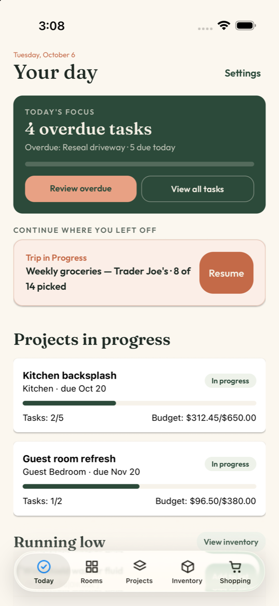
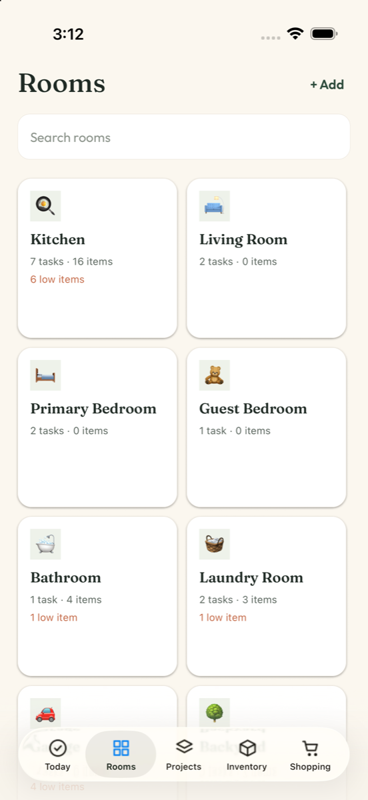
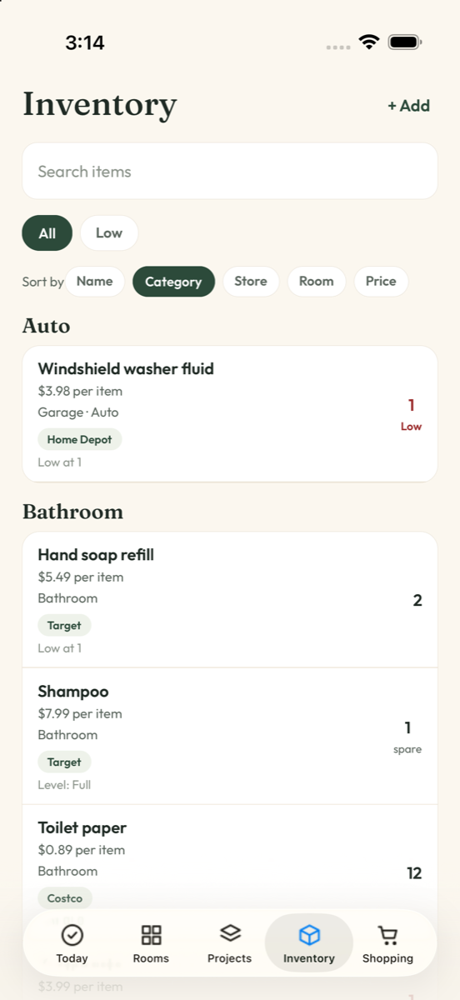
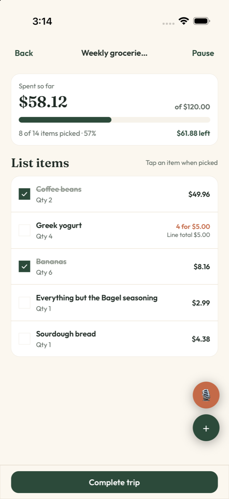
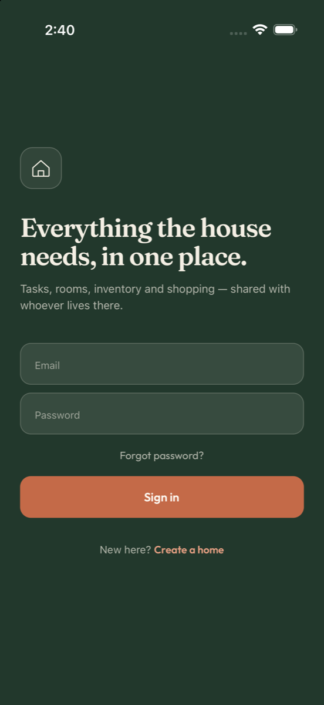

# Home Manager

A React Native app for running a household: rooms, recurring tasks, home projects, inventory, and shopping trips, with voice entry and offline sync. You can share it with whoever lives in the home.


<table>
  <tr>
    <td></td>
    <td></td>
    <td></td>
    <td></td>
    <td></td>
  </tr>
</table>

## Features

- **Today dashboard:** one screen showing tasks due today, low-stock items, the active shopping trip, and projects in progress.
- **Rooms:** each room has its own tasks, items, and notes.
- **Recurring tasks with natural-language input:** type "Change HVAC filter every 3 months" and the app sets up the task and its schedule ([`parse-task.ts`](src/task/parse-task.ts)).
- **Projects:** home projects with a status and their own task list.
- **Inventory:** tracks what's in the house and flags items running low. Low items can be added to the shopping list in one tap.
- **Shopping trips with voice entry:** say "milk, two loaves of bread, and eggs" and it becomes a list with quantities. Speech recognition is primed with items already in your inventory, which makes those names easier to recognize ([`voice-item-parser.ts`](src/lib/voice-item-parser.ts)).
- **Works offline:** changes made without a connection show up immediately and sync when the device reconnects.
- **Onboarding and accounts:** a guided setup for the home and its rooms, plus sign in, sign out, and in-app account deletion.

## Tech stack

| Area | Choice |
| --- | --- |
| Framework | Expo SDK 57, React Native 0.86 (New Architecture), React 19, React Compiler |
| Language | TypeScript (strict) |
| Navigation | Expo Router: file-based, typed routes, native tabs, protected route groups |
| Server state | TanStack Query with a persisted cache and a persisted mutation queue |
| Client state | Zustand (persisted) |
| Styling | NativeWind (Tailwind CSS), custom theme, Fraunces + Outfit fonts |
| Storage | expo-sqlite (offline cache and queue), expo-secure-store (auth token) |
| Native features | expo-speech-recognition, expo-haptics, expo-network, Reanimated, Gesture Handler |
| Builds | EAS Build / EAS Submit |

## Architecture highlights

### Offline-first mutations

Every write goes through one shared definition ([`offline-mutation.ts`](src/lib/offline/offline-mutation.ts)) that updates the cache optimistically and then queues the request. Queued requests are saved to SQLite with the TanStack Query cache, so they survive the app being closed. They are replayed in order within a single mutation scope. Network failures are retried until they get through, while a 4xx is final, so one bad request can't block the queue. Connectivity comes from `expo-network` ([`network.ts`](src/lib/offline/network.ts)).

### Temporary IDs for records created offline

A room created offline gets a `tmp-…` ID, so you can keep adding tasks to it before it syncs. When the server returns the real ID, it is recorded, and every queued request is rewritten to use it before being sent. Screens showing that record switch to the new ID without navigating away ([`temp-ids.ts`](src/lib/offline/temp-ids.ts)).

### Feature-based structure

Each domain (`room`, `task`, `project`, `inventory`, `shopping`, `today`) has the same layout: `api/` for HTTP calls, `hooks/` for queries and mutations, `*-model.ts` for pure domain logic, `*-mutations.ts` for offline mutation definitions, and its screens. Route files in [`src/app`](src/app) are thin and only render the matching screen.

### Auth

The JWT is kept in the iOS Keychain or Android Keystore through SecureStore, and cached in memory so requests don't read the keychain each time. A single API client attaches the token and signs the user out on any `401` ([`api-client.ts`](src/lib/api-client.ts), [`auth-token.ts`](src/auth/auth-token.ts)). Route access uses Expo Router's `Stack.Protected` guards for signed-out, onboarding, and signed-in states ([`_layout.tsx`](src/app/_layout.tsx)).

### Other details

- Query keys are defined in one place and scoped by home, so invalidation stays predictable ([`query-keys.ts`](src/lib/query-keys.ts)).
- Native modules that Expo Go doesn't ship are loaded only when present, so the app still runs in Expo Go with voice entry turned off ([`speech-recognition.ts`](src/lib/speech-recognition.ts)).
- Platform-specific files (`*.web.ts`) swap SQLite for browser storage on web.

## Project structure

```text
src/
├── app/            # Expo Router routes (thin), root layout, auth guards
├── auth/           # Sign in, create account, token storage
├── onboarding/     # First-run home and room setup
├── today/          # Dashboard
├── room/           # Rooms, with per-room tasks, items, notes
├── task/           # Tasks, recurrence, natural-language parsing
├── project/        # Home projects
├── inventory/      # Inventory and voice entry
├── shopping/       # Shopping lists, trips, voice entry
├── home/           # Current home and members
├── components/     # Shared UI (tabs, inputs, buttons, icons)
├── constants/      # Theme, categories, room emojis
├── store/          # Zustand app store
└── lib/            # API client, query client, offline sync, utilities
```

## Backend

The API is a separate NestJS service: [RGunn8/HomeManagerNest](https://github.com/RGunn8/HomeManagerNest).

- NestJS 11 with Prisma on PostgreSQL
- JWT auth with Passport and bcrypt, with Helmet for security headers
- OpenAPI docs through Swagger
- OpenAI-powered grocery extraction for shopping capture
- Deployed on Railway

## Getting started

**Prerequisites:** Node.js 20+, Xcode (iOS) or Android Studio (Android), and the backend running locally or a deployed API URL.

```bash
npm install
```

Point the app at the API in `.env.development`:

```bash
EXPO_PUBLIC_API_URL=http://localhost:3000
```

On a physical device, use your computer's LAN IP instead of `localhost`.

Build and run the native app:

```bash
npx expo run:ios       # or: npx expo run:android
```

After the first build, `npx expo start` is enough for JavaScript-only changes. The app also opens in Expo Go, but voice entry needs a native build.

| Script | What it does |
| --- | --- |
| `npm run start:dev` | Start Metro against the local API |
| `npm run ios` / `npm run android` | Build and run the native app |
| `npm run build:dev` | EAS development build |
| `npm run build:prod` | EAS production build |
| `npm run lint` | ESLint |

## Status and roadmap

- [x] Rooms, tasks, projects, inventory, shopping trips
- [x] Voice entry for shopping and inventory
- [x] Offline sync with a persisted mutation queue
- [ ] App Store release (in progress)
- [ ] Password reset
- [ ] Inviting household members (backend support exists)

## Author

Ryan Gunn · [LinkedIn](https://www.linkedin.com/in/ryangunn1/) · [GitHub](https://github.com/RGunn8)
